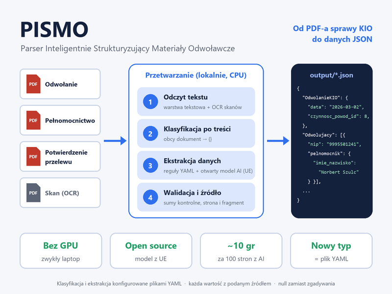

# PISMO — Parser Inteligentnie Strukturyzujący Materiały Odwoławcze

**Od PDF-a sprawy KIO do danych JSON** — rozwiązanie wyzwania *Odwołania2json* (HackNation 2026, Urząd Zamówień Publicznych).

## Uruchomienie

**Wymagania:** tylko **Docker** — [Docker Desktop](https://www.docker.com/products/docker-desktop/) (Windows / macOS) albo Docker Engine z Docker Compose (Linux), **uruchomiony** przed startem. Do tego dostęp do internetu (pierwsze zbudowanie obrazu, wywołania AI) i ok. 3 GB wolnego miejsca na dysku. Nie trzeba instalować Pythona ani niczego innego; GPU nie jest potrzebne.

1. **Klucz AI:** umieść otrzymany plik `.env.overdrive` w głównym folderze projektu (obok `start.bat`). Bez niego aplikacja też działa, ale na samych regułach (bez AI).
2. **Dokumenty:** wrzuć pliki PDF do folderu `input/` (dowolne podfoldery i nazwy plików).
3. **Start:**
   - **Windows:** dwuklik na `start.bat`
   - **Linux / macOS:** `sh start.sh`

Wyniki pojawią się w folderze **`output/`** — ta sama struktura folderów i te same nazwy plików, z rozszerzeniem `.json`:

```
input/case1/odwolanie_nr_1.pdf   ->   output/case1/odwolanie_nr_1.json
input/case1/przelew.pdf          ->   output/case1/przelew.json
input/case2/inny_dokument.pdf    ->   output/case2/inny_dokument.json   ({} — dokument spoza obsługiwanych typów)
```

Pierwsze uruchomienie buduje obraz Dockera (kilka minut, jednorazowo); kolejne startują od razu. Metadane (typ dokumentu, źródło każdej wartości) trafiają osobno do `meta/`, więc `output/` zawiera wyłącznie JSON-y w formacie UZP.

> W terminalu `cmd` uruchamiaj `.\start.bat` (samo `start.bat` cmd myli z wbudowanym poleceniem `START`).

**Serwer oceniający (Linux, `/opt/solution`):** komenda i opis usług są w [`RUN.md`](RUN.md) — `docker compose --profile batch run --rm -T cli`, bez interakcji, z kluczem w `/opt/solution/.env`.

---

## Co robi PISMO

PISMO przyjmuje dokumenty sprawy odwoławczej (odwołanie, pełnomocnictwo, potwierdzenie przelewu — PDF cyfrowe lub skany), **rozpoznaje typ dokumentu po treści**, wyodrębnia dane i zapisuje JSON **ściśle zgodny z modelem UZP** (`oczekiwane-json`). Dokument spoza obsługiwanych klas daje plik z `{}`.



- **Działa lokalnie w Dockerze**, na zwykłym laptopie bez GPU (OCR na CPU).
- **Konfiguracja zamiast kodu:** typy dokumentów, pola, reguły i rozpoznawanie — w plikach YAML.
- **Trzy tryby:** same reguły (bez AI, bez kosztów), reguły + AI (domyślny) albo samo AI — otwarty model hostowany w UE.
- **Przejrzystość:** przy każdej wartości wiadomo, z której strony i z jakiego fragmentu pochodzi oraz czy dała ją reguła, czy AI.

## Ustawienia i tryb z AI (klucz API)

**Domyślnie aplikacja korzysta z AI** (tryb `hybrid`, Mistral AI — endpoint UE). Potrzebny jest tylko klucz API; bez klucza aplikacja działa na samych regułach i informuje o tym.

Ustawienia są czytane z **jednego** pliku w głównym folderze projektu:

| Plik | Kiedy jest używany |
|---|---|
| `.env.overdrive` | **jeśli istnieje — ma pierwszeństwo, a `.env` jest całkowicie pomijany** |
| `.env` | gdy nie ma `.env.overdrive` (tworzony z `.env.example` przy pierwszym uruchomieniu `start.bat` / `start.sh`) |

Oba pliki są w `.gitignore` — klucz nigdy nie trafia do repozytorium.

**Dla jury:** plik `.env.overdrive` z kluczem przekazujemy osobno, poza publicznym repozytorium — wystarczy umieścić go w głównym folderze projektu i uruchomić `start.bat` / `start.sh`.

Własna konfiguracja (w `.env` lub `.env.overdrive`):
```
LLM_API_KEY=<klucz z https://console.mistral.ai>
EXTRACTION_MODE=hybrid        # rules | hybrid | llm
```

| `EXTRACTION_MODE` | Działanie |
|---|---|
| `rules` | tylko reguły z YAML (bez AI, bez kosztów) |
| `hybrid` (domyślny, zalecany) | najpierw reguły, potem AI uzupełnia luki i rozstrzyga trudne pola (powód odwołania, data czynności, imiona i nazwiska w mianowniku); spory reguła–AI rozstrzyga krótkie drugie zapytanie (arbitraż) |
| `llm` | cały JSON od modelu (reguły nieużywane) |

Jeśli API jest niedostępne, aplikacja nie przerywa pracy — zwraca wynik z reguł i zapisuje informację w metadanych. CLI przetwarza kilka dokumentów jednocześnie (`WORKERS`, domyślnie 4) — wywołania AI jednych dokumentów nakładają się na OCR innych.

Bez Dockera (Python 3.13+): `pip install -r requirements.txt`, potem `python -m src process --input input --output output`.

### Użyty model językowy

| | |
|---|---|
| Model | **Ministral 3 14B** (`ministral-14b-2512`) — otwarte wagi, licencja **Apache 2.0**, możliwy do instalacji lokalnej |
| Dostawca | **Mistral AI** (Francja), endpoint UE: `https://api.eu.mistral.ai/v1` |
| Przetwarzanie danych | centra danych w UE (endpoint regionalny UE) — [polityka prywatności i kontrola danych Mistral AI](https://docs.mistral.ai/admin/security-access/privacy) |
| Koszt | ok. $0,20 / 1 mln tokenów; **ok. 10 gr za 100 stron** w trybie z AI |
| Zapasowo | Google Cloud Vertex AI, Mistral Small 3.1 w regionie `europe-west4` (`LLM_PROVIDER=vertex`) |

Do modelu wysyłany jest tekst dokumentu. Każda odpowiedź AI przechodzi te same kontrole co reguły (format, sumy kontrolne NIP/REGON/PESEL/IBAN) **i musi występować w treści dokumentu** — wartości wymyślone przez model są odrzucane. Odpowiedzi są zapisywane w `cache/llm/`, więc ten sam dokument nie jest opłacany dwa razy.

## GUI i API

```
docker compose up -d --build
```

- **GUI:** http://localhost:8501 — wgranie PDF-ów, uruchomienie analizy, **podgląd strony dokumentu obok wyodrębnionych danych**; wybór pola pokazuje stronę i fragment, z którego pochodzi wartość. Pobieranie JSON-ów (pojedynczo lub ZIP).
- **API:** http://localhost:8000/docs
  - `POST /extract` — wgrany PDF → JSON (UZP) + metadane (klasyfikacja, źródło pól, użycie AI)
  - `GET /document-types` — typy dokumentów wczytane z konfiguracji
  - `GET /health`

## Jakość — wyniki testów

Metoda zgodna z zasadami UZP: F1 na poziomie pól, pola typu „długi string” zaliczane przy podobieństwie ≥ 80%, listy dopasowywane po treści.

- **Zbiór treningowy** organizatora: 60 spraw × 3 dokumenty + 17 dokumentów negatywnych (PDF z warstwą tekstową).
- **Skany** organizatora: 30 zeskanowanych dokumentów (OCR) **o układach, których reguły nie widziały** — najlepsza miara działania na nowych dokumentach.

| F1 | Tylko reguły | Samo AI | **Reguły + AI** (domyślny) |
|---|---|---|---|
| zbiór treningowy | 1,000 | 0,946 | **1,000** |
| skany (nowe układy, OCR) | 0,752 | 0,932 | **0,987** |
| klasyfikacja (trening / skany) | 198/198 · 30/30 | 198/198 · 30/30 | 198/198 · 30/30 |

Pełne raporty: [`reports/`](reports/) — `uzp_training*.md` (trening), `uzp_skany*.md` (skany); sufiks `_hybrid` = reguły + AI. Reguły dają pewne formaty i identyfikatory, AI — mianownik nazwisk, nowe układy dokumentów i brakujące pola; każda odpowiedź AI jest sprawdzana z treścią dokumentu.

Numer rachunku jest zapisywany tak, jak w dokumencie (z prefiksem `PL`, jeśli go zawiera — zgodnie z wyjaśnieniem jury). Część wzorców treningowych nie ma `PL`, dlatego metryka UZP porównuje rachunki po cyfrach (`digits_only_fields`), a metryka dokładna pokazuje tę różnicę.

Uruchomienie ewaluacji (dane organizatora wskazane w `.env` jako `UZP_DATA_DIR`):
```
docker compose run --rm tests python -m src.evaluation                     # tylko reguły (bezpłatnie)
docker compose run --rm -e LLM_PROVIDER=openai tests python -m src.evaluation --mode hybrid --estimate   # szacunek kosztu
docker compose run --rm -e LLM_PROVIDER=openai tests python -m src.evaluation --mode hybrid
docker compose run --rm tests                                              # testy automatyczne (bez płatnych wywołań)
```

## Dodawanie nowego typu dokumentu (bez programowania)

Nowy typ dokumentu to **jeden plik YAML** w `config/document_types/` — po zapisaniu jest od razu rozpoznawany i przetwarzany (CLI, API, GUI, tryb z AI). Instrukcja krok po kroku: [`docs/nowy-typ-dokumentu.md`](docs/nowy-typ-dokumentu.md). Architektura: [`docs/architektura.md`](docs/architektura.md).

## Znane ograniczenia

- **Imiona i nazwiska w trybie samych reguł** są zwracane w formie z dokumentu. Automatyczna odmiana polskich nazwisk regułami nie może być w 100% poprawna (np. „Leszkowi → Leszek”, ale „Kowalikowi → Kowalik”; nieodmienne nazwiska żeńskie), dlatego mianownik zapewnia tryb z AI.
- **OCR skanów** działa na CPU — ok. 3–5 s na stronę (OpenVINO, model detekcji PP-OCRv6 tiny). Ze skanu czytane są **2 pierwsze strony** (`OCR_MAX_PAGES`) — tam są wszystkie dane, dalej jest uzasadnienie; strony z warstwą tekstową czytane są zawsze w całości. Wynik OCR jest zapamiętywany w `cache/ocr/`.
- **Wyniki 1,000** dotyczą zbioru treningowego; na nowych układach (skany) reguły + AI dają 0,987.

## Struktura projektu

```
config/document_types/   typy dokumentów (YAML): klasyfikacja, pola, reguły, zasady AI
config/dictionaries/     słowniki (np. powody odwołania 1–12)
config/evaluation/       zbiory ewaluacyjne i zasady metryki
src/ingestion/           PDF → tekst (pypdfium2) + OCR skanów (RapidOCR / ONNX, CPU)
src/classification/      rozpoznawanie typu dokumentu po treści
src/extraction/          silnik reguł sterowany YAML
src/validation/          typy wartości, normalizacja, sumy kontrolne
src/llm/                 klienci LLM, prompt ze schematu YAML, walidacja i scalanie, pamięć odpowiedzi
src/evaluation/          metryka F1 zgodna z UZP, raporty
src/cli.py, src/api/     CLI (input/ → output/) i API (FastAPI)
ui/app.py                GUI (Streamlit)
tests/                   testy automatyczne (AI zastąpione atrapą — bez kosztów)
```

Wszystkie komponenty są open source (MIT / BSD / Apache-2.0); wersje bibliotek przypięte w `requirements.txt`.

## Licencja

Projekt jest udostępniony na licencji [Apache License 2.0](LICENSE).
